<div align="center">

# feyegetsu.dev

**Сайты, Telegram-боты и Mini App для малого бизнеса**

[](https://github.com/feyegetsu/portfolio/actions/workflows/ci.yml)
[](https://github.com/feyegetsu/portfolio/actions/workflows/screenshots.yml)


[](LICENSE)

### [Открыть портфолио →](https://feyegetsu.github.io/portfolio/)

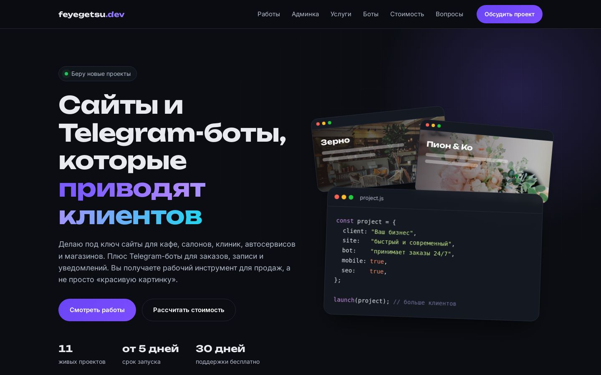

</div>

## Что внутри

**11 живых проектов**: 9 сайтов для разных ниш, Telegram-бот и общий бэкенд с админкой. Каждый можно потрогать: оформить заказ, записаться, посчитать ипотеку. На главной у каждого проекта есть кейс с задачей, решением, техническими деталями и интерактивным превью в рамке компьютера или телефона.

| | Проект | Ниша | Ключевая фишка |
|---|---|---|---|
| 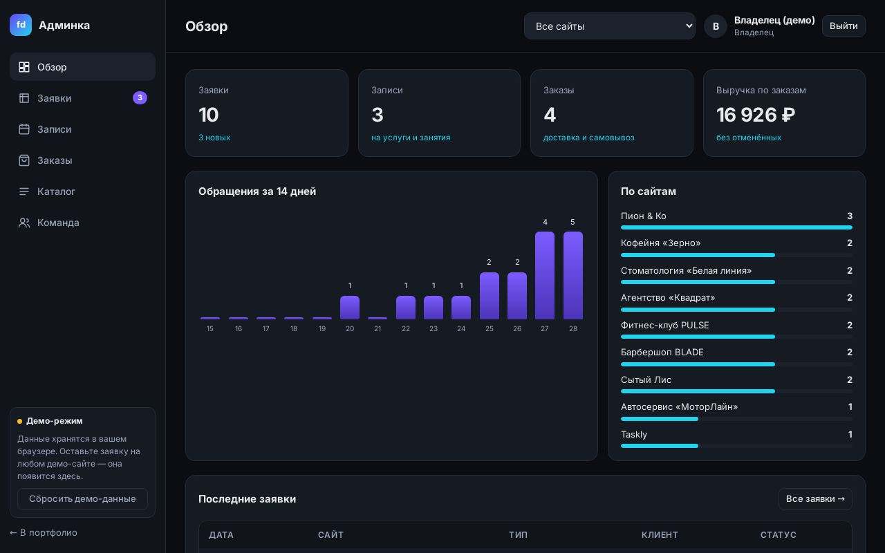 | [**Админка и API**](https://feyegetsu.github.io/portfolio/admin/) | Бэкенд | Все заявки, записи и заказы с сайтов, роли сотрудников, цены и стоп-лист. [Код →](backend/) |
| 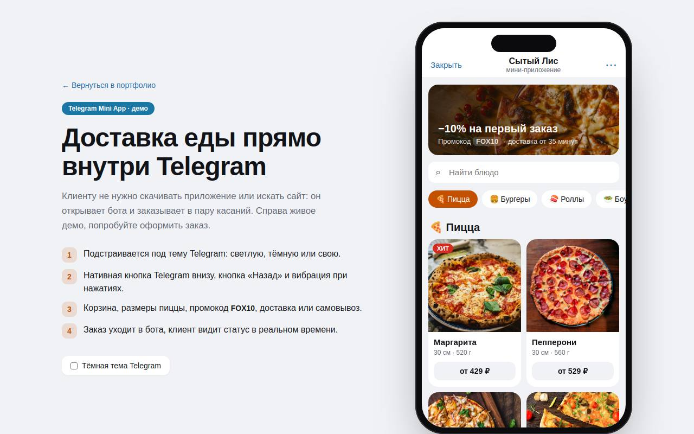 | [**Сытый Лис**](https://feyegetsu.github.io/portfolio/projects/miniapp/) | Telegram Mini App | Доставка еды внутри Telegram: тема, MainButton, вибрация, статус заказа |
| 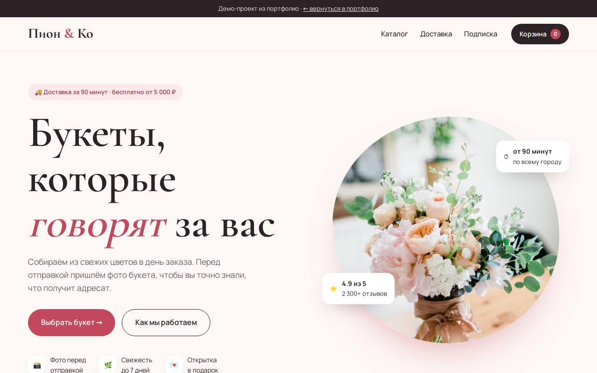 | [**Пион & Ко**](https://feyegetsu.github.io/portfolio/projects/florist/) | Интернет-магазин | Каталог с фильтрами, корзина с сохранением, доставка по интервалам |
| 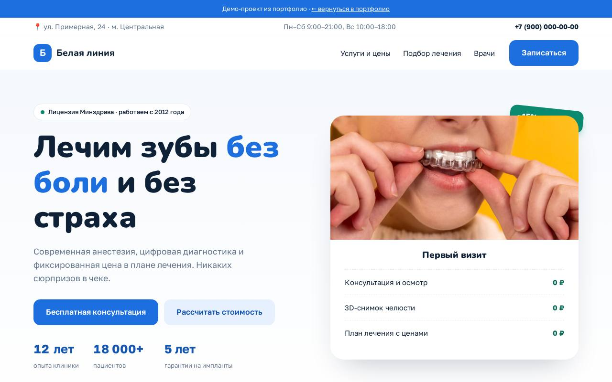 | [**Белая линия**](https://feyegetsu.github.io/portfolio/projects/dental/) | Медицина | Квиз, который считает стоимость лечения |
| 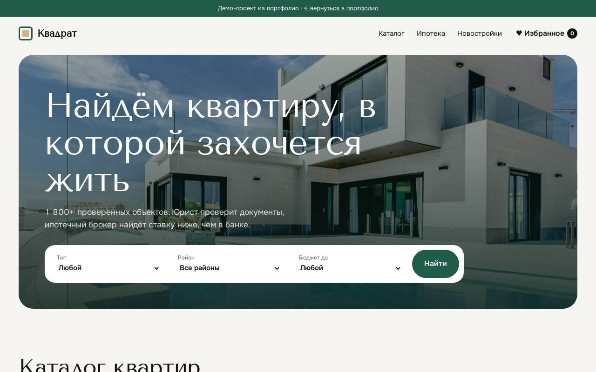 | [**Квадрат**](https://feyegetsu.github.io/portfolio/projects/realty/) | Недвижимость | Фильтры, избранное, галерея объекта, ипотечный калькулятор |
| 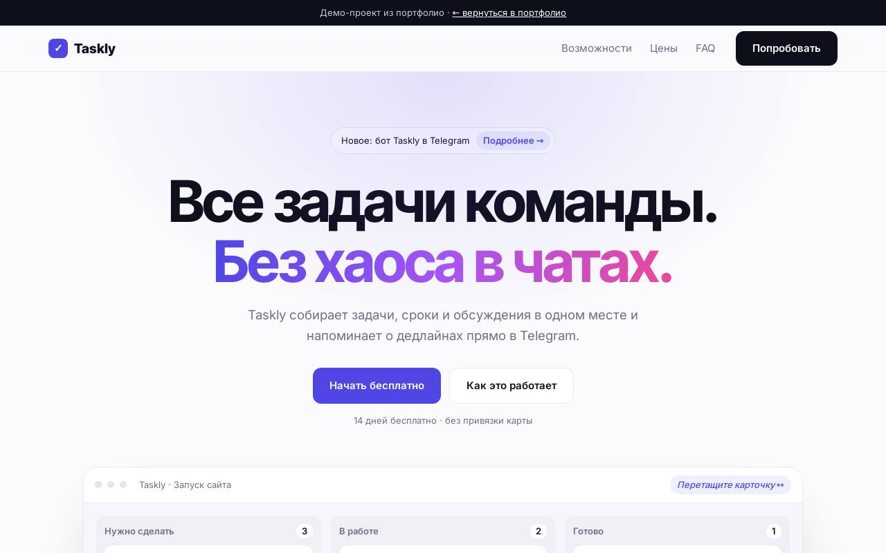 | [**Taskly**](https://feyegetsu.github.io/portfolio/projects/saas/) | IT-стартап | Канбан с drag & drop мышью и пальцем, расчёт тарифа |
| 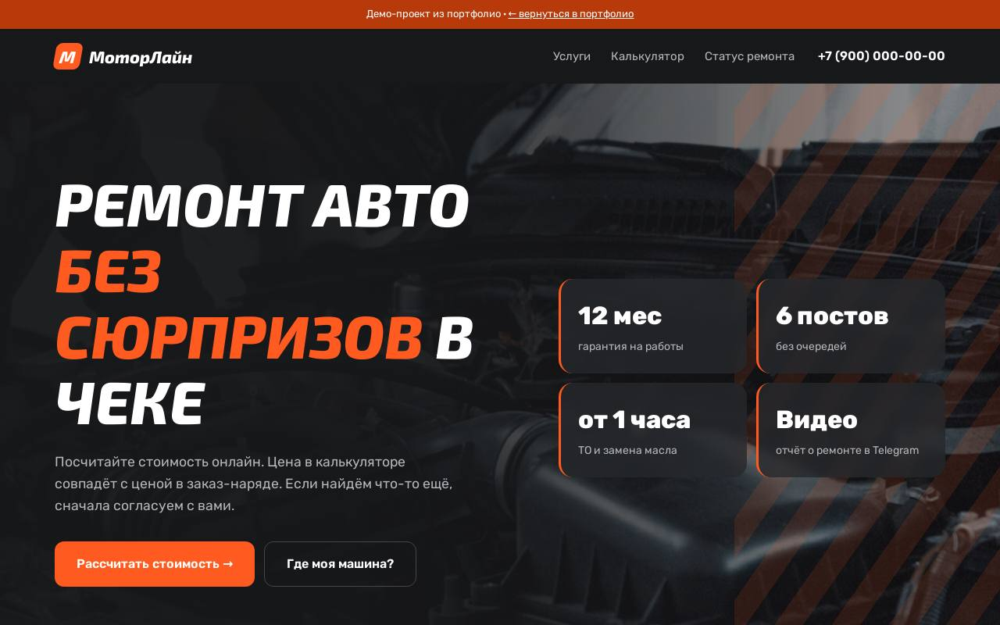 | [**МоторЛайн**](https://feyegetsu.github.io/portfolio/projects/autoservice/) | Авто | Калькулятор ремонта, отслеживание статуса машины |
| 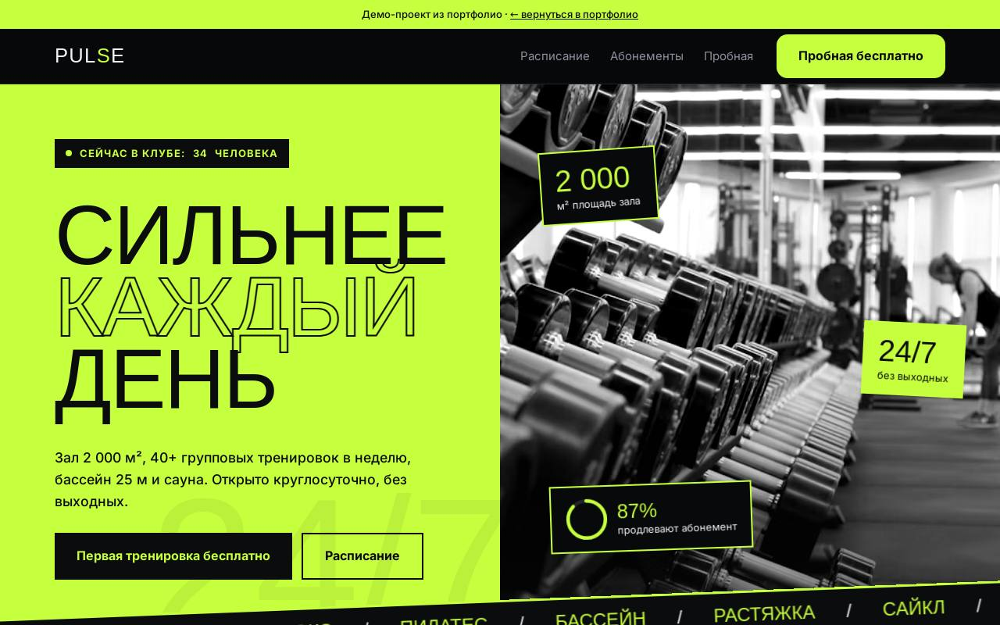 | [**PULSE**](https://feyegetsu.github.io/portfolio/projects/fitness/) | Спорт | Сайт-плакат: расписание с записью и свободными местами |
| 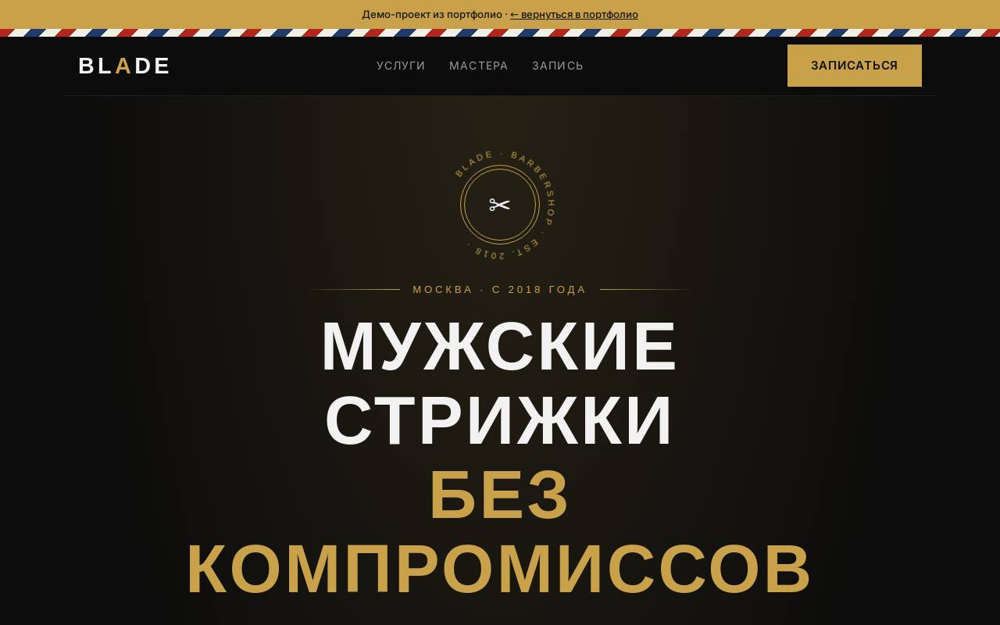 | [**BLADE**](https://feyegetsu.github.io/portfolio/projects/barbershop/) | Красота | Олдскульная вывеска и онлайн-запись в 3 шага |
| 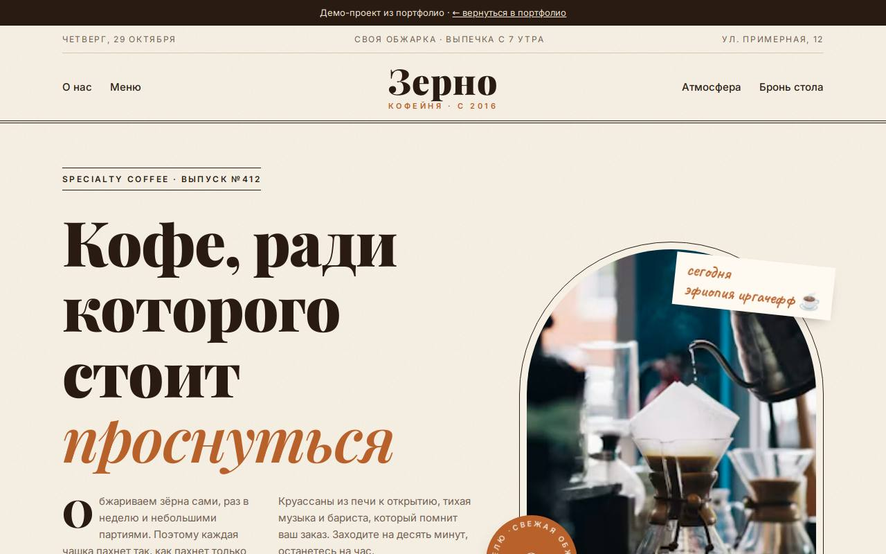 | [**Зерно**](https://feyegetsu.github.io/portfolio/projects/cafe/) | Общепит | Вёрстка в стиле газеты: печатное меню, полароиды, бронь-билет |
| 🤖 | [**Бот для заказов**](projects/cafe-bot/) | Telegram-бот | Python + aiogram 3: корзина, заказы в SQLite, уведомления админу, рассылки |

### Бэкенд и админка

Формы на всех сайтах отправляют данные в общий API, а владелец управляет ими в админке. Попробуйте сами: оставьте заявку на любом сайте и откройте [админку](https://feyegetsu.github.io/portfolio/admin/) (вход `demo@feyegetsu.dev` / `demo`). Поменяйте цену в каталоге или статус заказа, и Mini App обновится сам.

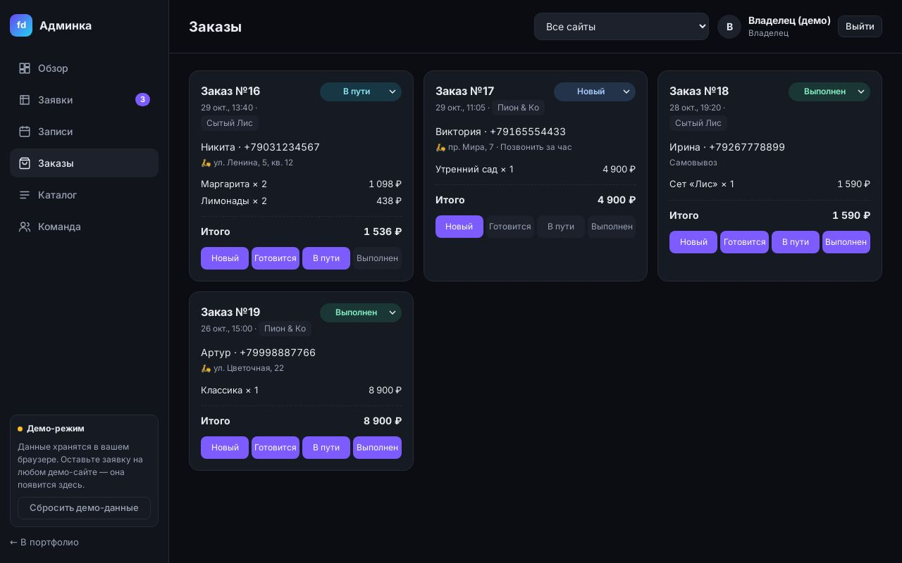

- **API на FastAPI**: заявки, запись на время без двойных записей, заказы с ценами из каталога, статистика, выгрузка в CSV.
- **Роли и доступ**: владелец, администратор, сотрудник; сотрудник видит только свои сайты.
- **Защита форм**: валидация телефона, honeypot, лимит заявок с одного IP.
- **23 автотеста** на pytest, Docker и docker-compose с PostgreSQL, отдельная проверка в CI.
- **Демо-режим.** На GitHub Pages сервер запустить нельзя, поэтому клиент [`api.js`](projects/shared/api.js) повторяет контракт и правила API прямо в браузере. С настоящим сервером он работает через параметр `?api=`.

Подробнее, со схемой и списком эндпоинтов: [backend/README.md](backend/README.md).

<div align="center">
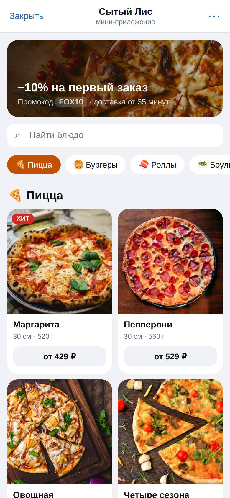
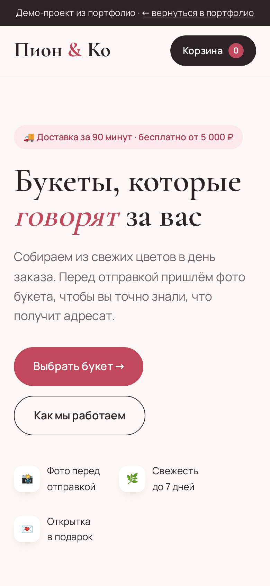
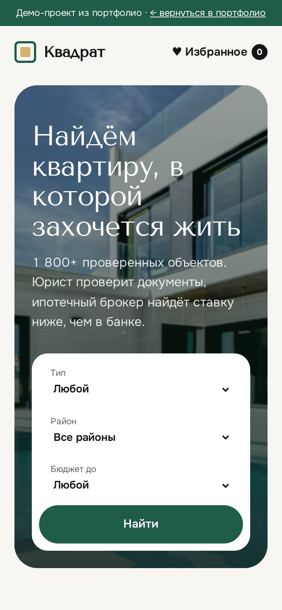
</div>

### Кейсы

У каждого проекта есть кейс: задача бизнеса, что сделано, как устроено внутри, и живое превью, которое можно переключать между компьютером и телефоном. На кейс можно дать прямую ссылку, например [#case-miniapp](https://feyegetsu.github.io/portfolio/#case-miniapp).

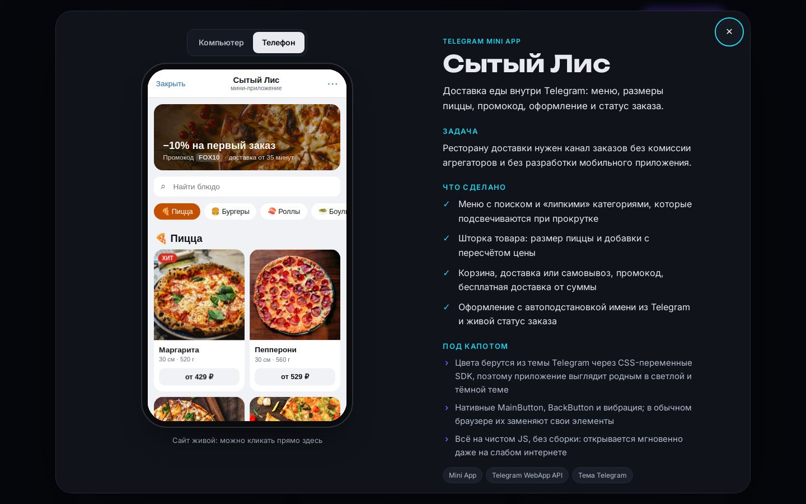

## Качество, которое можно проверить

Цифры не написаны руками: их считает Lighthouse в GitHub Actions при каждом изменении сайта и кладёт в [`assets/lighthouse.json`](assets/lighthouse.json).

<!-- LIGHTHOUSE:START -->
Замер от 2026-10-29. Страницы без пометки измерены в мобильном режиме (медленный 4G, слабый процессор).

| Страница | Скорость | Доступность | Практики | SEO | LCP |
|---|---|---|---|---|---|
| Главная (телефон) | 🟢 99 | 🟢 100 | 🟢 100 | 🟢 100 | 1.8 s |
| Главная (компьютер) | 🟢 95 | 🟢 100 | 🟢 100 | 🟢 100 | 1.3 s |
| Mini App | 🟢 92 | 🟢 100 | 🟢 100 | 🟢 100 | 2.6 s |
| Пион & Ко | 🟢 99 | 🟢 100 | 🟢 100 | 🟢 100 | 2.1 s |
| Белая линия | 🟢 99 | 🟢 99 | 🟢 100 | 🟢 100 | 1.8 s |
| Зерно | 🟢 99 | 🟢 96 | 🟢 100 | 🟢 100 | 1.8 s |
| BLADE | 🟢 99 | 🟢 100 | 🟢 100 | 🟢 100 | 2.1 s |
| PULSE | 🟢 99 | 🟢 100 | 🟢 100 | 🟢 100 | 1.8 s |
| МоторЛайн | 🟠 82 | 🟢 100 | 🟢 100 | 🟢 100 | 1.9 s |
| Квадрат | 🟢 99 | 🟢 100 | 🟢 100 | 🟢 100 | 1.8 s |
| Taskly | 🟢 100 | 🟢 100 | 🟢 100 | 🟢 100 | 1.5 s |
<!-- LIGHTHOUSE:END -->

- **CI на каждый пуш.** Бот проходит линтер `ruff` и проверку импорта, все HTML-страницы проверяются на битые ссылки.
- **Скриншоты обновляются сами.** Playwright снимает каждый проект и OG-картинку и коммитит их в `assets/`.
- **Доступность.** Семантическая разметка, фокус с клавиатуры, модальные окна на `<dialog>`, учёт `prefers-reduced-motion`.
- **SEO.** Мета-теги, Open Graph, JSON-LD `ProfessionalService`, `sitemap.xml`, `robots.txt`, canonical.

## Как устроено

```
index.html, styles.css, script.js   главная: кейсы, калькулятор стоимости, симуляция бота
projects/
  miniapp/                          Telegram Mini App (Telegram WebApp API)
  florist/ dental/ realty/ saas/
  autoservice/ fitness/ barbershop/ cafe/
  shared/motion.js                  анимации через data-атрибуты: появление, параллакс, счётчики
  shared/api.js                     клиент API: настоящий сервер или демо-режим в браузере
  cafe-bot/                         Telegram-бот на Python (aiogram 3, SQLite)
admin/                              админ-панель: дашборд, заявки, записи, заказы, каталог, команда
backend/                            API на FastAPI: модели, роуты, тесты, Dockerfile, docker-compose
tools/
  screenshots.py                    скриншоты и OG-картинка (Playwright)
  lh_summary.py                     сводка отчётов Lighthouse
.github/workflows/
  ci.yml                            тесты API, линтеры, проверка ссылок, сборка Docker
  screenshots.yml                   скриншоты и Lighthouse с автокоммитом
```

**Почему фронтенд без фреймворков.** Для сайтов малого бизнеса важнее всего скорость загрузки с мобильного и простота поддержки. Чистые HTML, CSS и JS открываются с любого хостинга и не требуют сборки, а каждый демо-проект — один файл, который легко взять за основу под реального клиента. Сложная логика живёт на сервере.

## Запуск локально

```bash
git clone https://github.com/feyegetsu/portfolio.git
cd portfolio
python -m http.server 8000
```

Откройте http://localhost:8000. Контакты на главной задаются в одном месте: объект `CONFIG` в начале [`script.js`](script.js).

Бэкенд запускается одной командой `docker compose up` из папки [`backend`](backend/README.md). Бот запускается отдельно, инструкция в [`projects/cafe-bot/README.md`](projects/cafe-bot/README.md).

## Лицензия

Код распространяется по лицензии [MIT](LICENSE). Фото загружаются с [Unsplash](https://unsplash.com/license), шрифты с Google Fonts. Компании, люди, отзывы и цифры в демо-проектах вымышлены.
