<div align="center">

# feyegetsu.dev

**Сайты, Telegram-боты и Mini App для малого бизнеса**

[](https://github.com/feyegetsu/portfolio/actions/workflows/ci.yml)
[](https://github.com/feyegetsu/portfolio/actions/workflows/screenshots.yml)
[](https://github.com/feyegetsu/portfolio/actions/workflows/deploy.yml)


[](LICENSE)

### [Открыть портфолио →](https://feyegetsu.github.io/portfolio/)

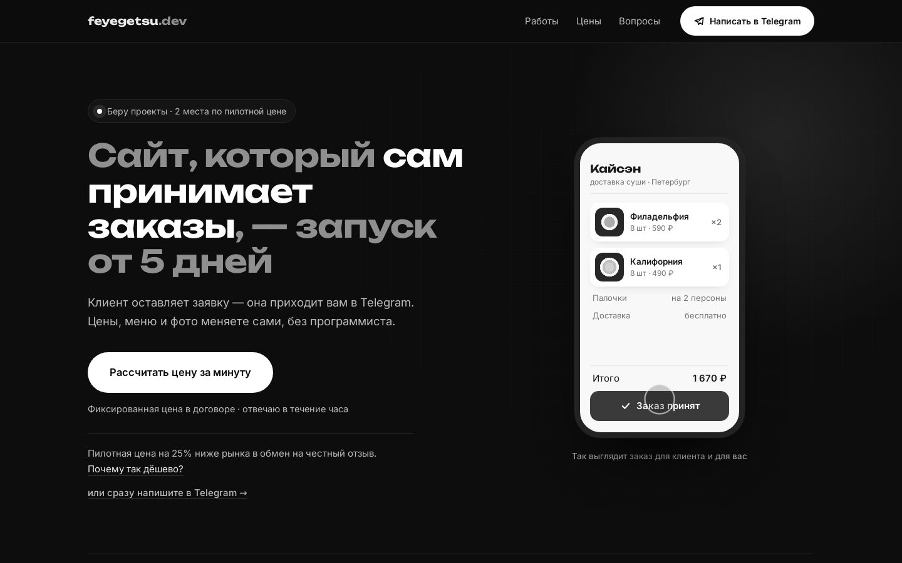

</div>

## Что внутри

**15 рабочих демо-проектов**: 13 сайтов для разных ниш, Telegram-бот и общий бэкенд с админкой. Каждый можно потрогать: оформить заказ, записаться, посчитать ипотеку. На главной у каждого проекта есть кейс с задачей, решением, техническими деталями и интерактивным превью в рамке компьютера или телефона.

| | Проект | Ниша | Ключевая фишка |
|---|---|---|---|
| 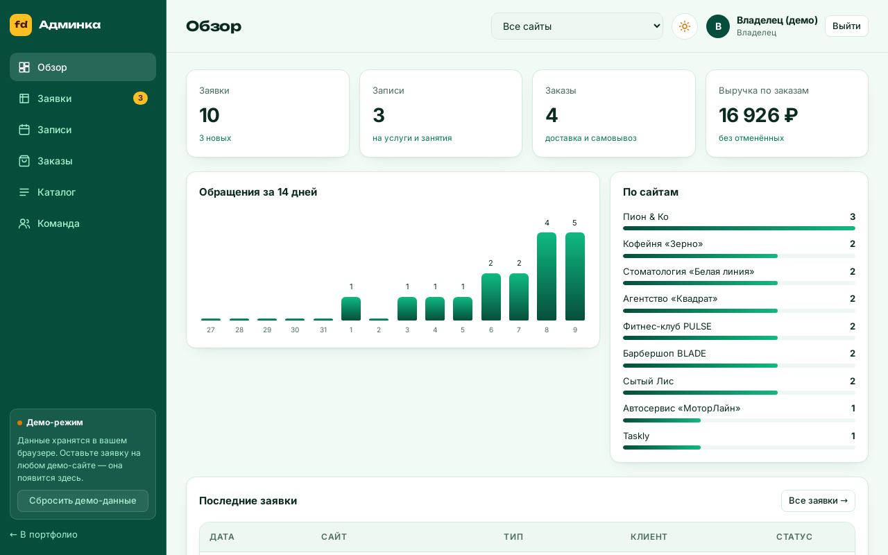 | [**Админка и API**](https://feyegetsu.github.io/portfolio/admin/) | Бэкенд | Все заявки, записи и заказы с сайтов, роли сотрудников, цены и стоп-лист. [Код →](backend/) |
| 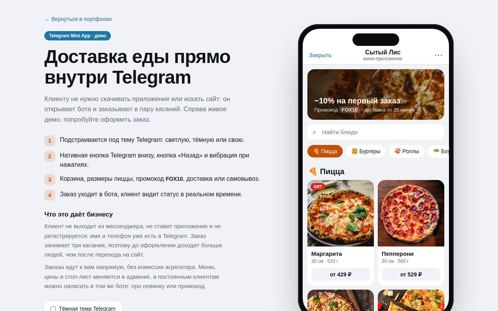 | [**Сытый Лис**](https://feyegetsu.github.io/portfolio/projects/miniapp/) | Telegram Mini App | Доставка еды внутри Telegram: тема, MainButton, вибрация, статус заказа |
| 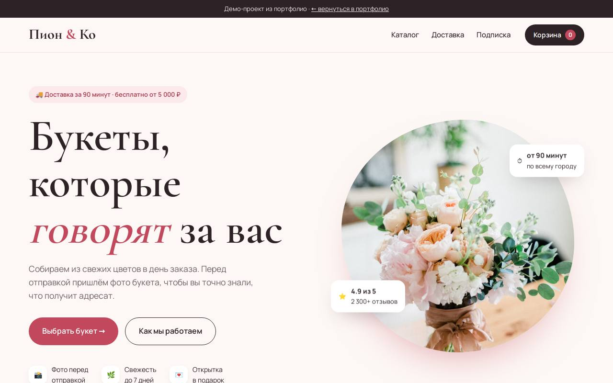 | [**Пион & Ко**](https://feyegetsu.github.io/portfolio/projects/florist/) | Интернет-магазин | Каталог с фильтрами, корзина с сохранением, доставка по интервалам |
| 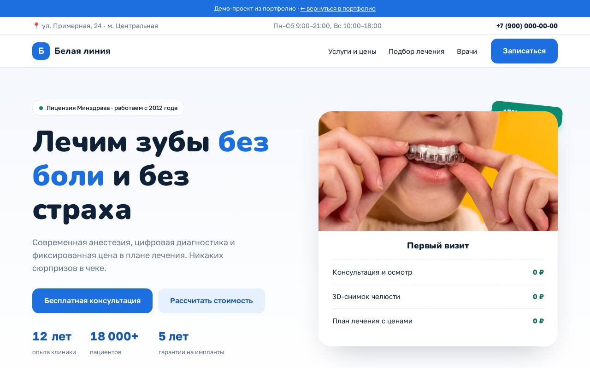 | [**Белая линия**](https://feyegetsu.github.io/portfolio/projects/dental/) | Медицина | Квиз, который считает стоимость лечения |
| 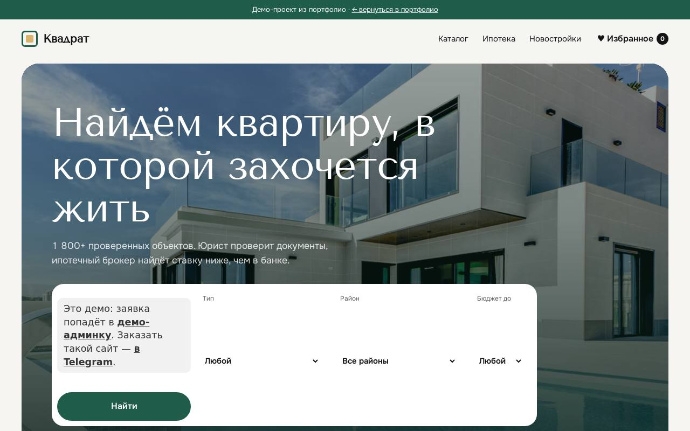 | [**Квадрат**](https://feyegetsu.github.io/portfolio/projects/realty/) | Недвижимость | Фильтры, избранное, галерея объекта, ипотечный калькулятор |
| 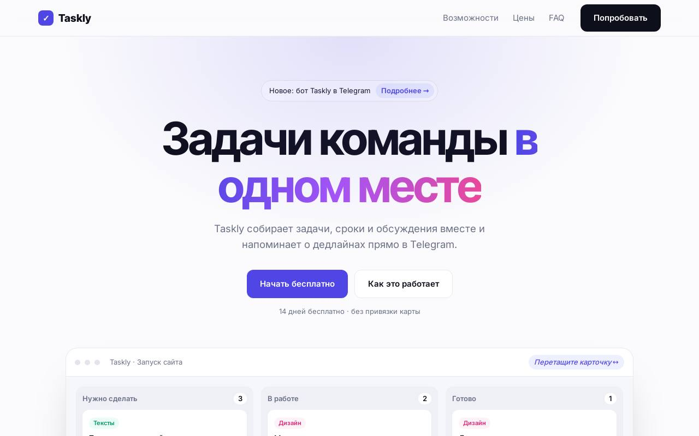 | [**Taskly**](https://feyegetsu.github.io/portfolio/projects/saas/) | IT-стартап | Канбан с drag & drop мышью и пальцем, расчёт тарифа |
| 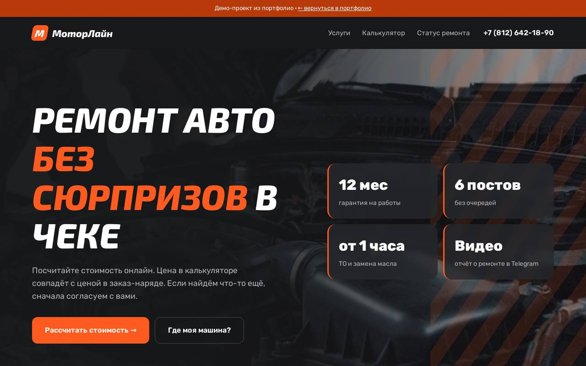 | [**МоторЛайн**](https://feyegetsu.github.io/portfolio/projects/autoservice/) | Авто | Калькулятор ремонта, отслеживание статуса машины |
| 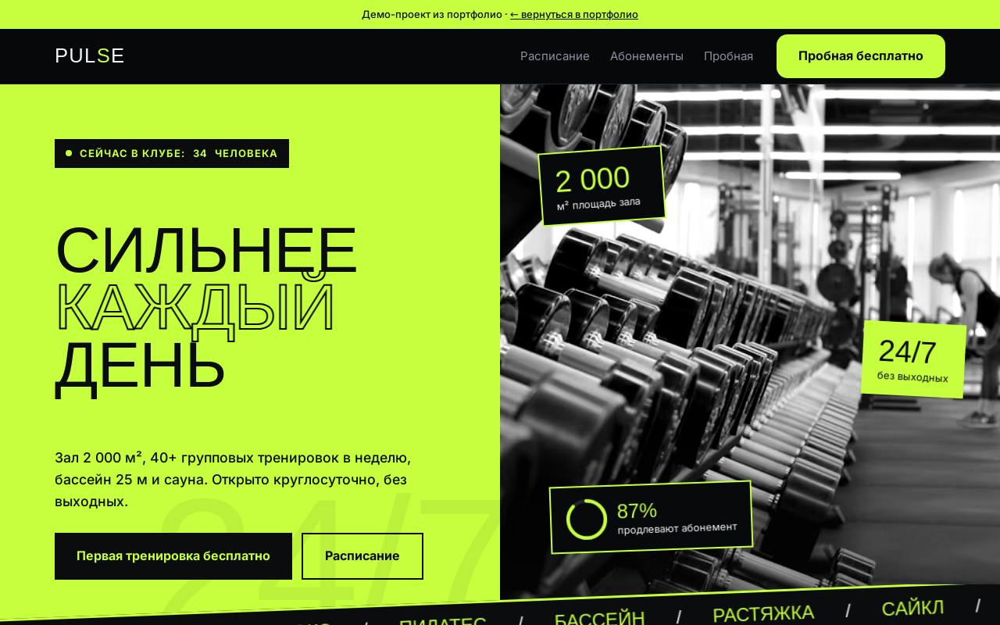 | [**PULSE**](https://feyegetsu.github.io/portfolio/projects/fitness/) | Спорт | Сайт-плакат: расписание с записью и свободными местами |
| 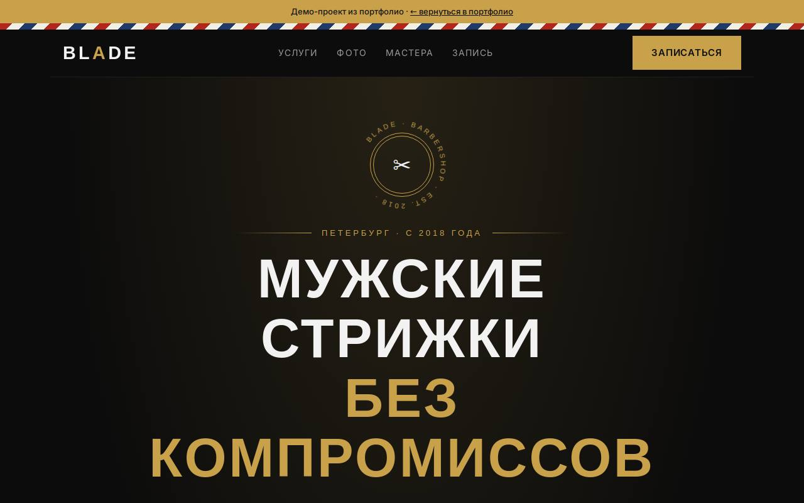 | [**BLADE**](https://feyegetsu.github.io/portfolio/projects/barbershop/) | Красота | Олдскульная вывеска и онлайн-запись в 3 шага |
| 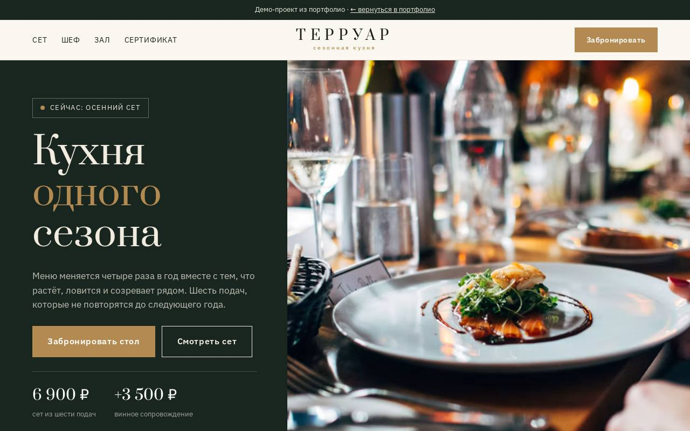 | [**Терруар**](https://feyegetsu.github.io/portfolio/projects/restaurant/) | Ресторан | Сезонный дегустационный сет, винное сопровождение, бронь стола по слотам |
| 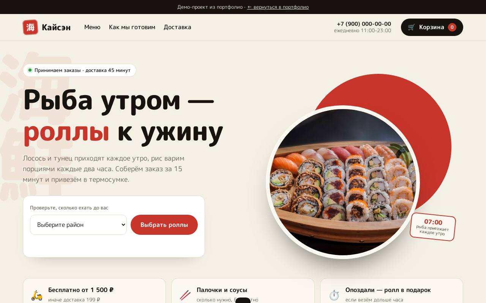 | [**Кайсэн**](https://feyegetsu.github.io/portfolio/projects/sushi/) | Доставка суши | Зоны доставки, корзина, стоп-лист из админки, статус заказа |
| 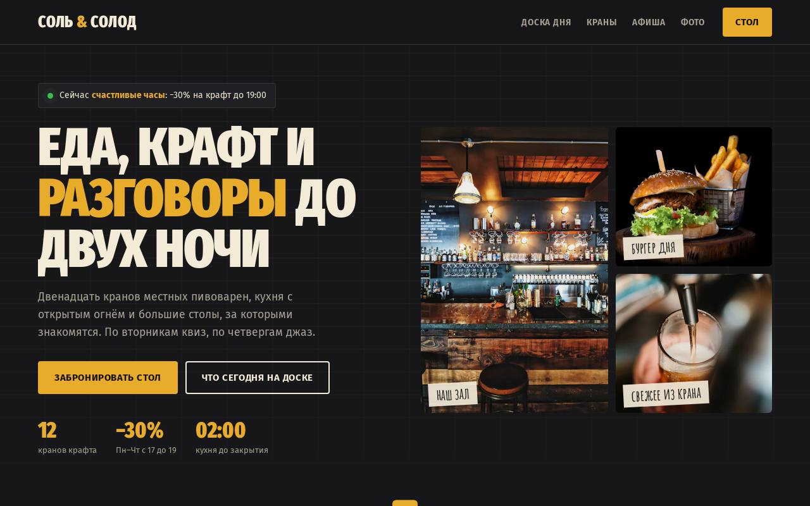 | [**Соль и Солод**](https://feyegetsu.github.io/portfolio/projects/gastrobar/) | Гастробар | Доска дня, краны, подбор пары к блюду, афиша с записью |
| 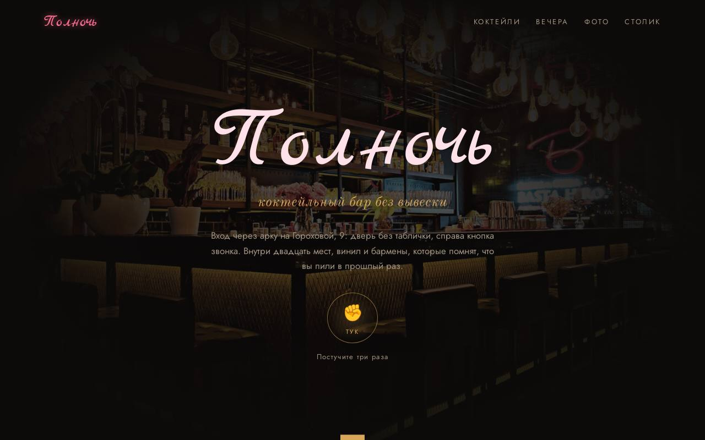 | [**Полночь**](https://feyegetsu.github.io/portfolio/projects/bar/) | Коктейльный бар | 18+, «постучите в дверь», квиз по коктейлям, гест-лист |
| 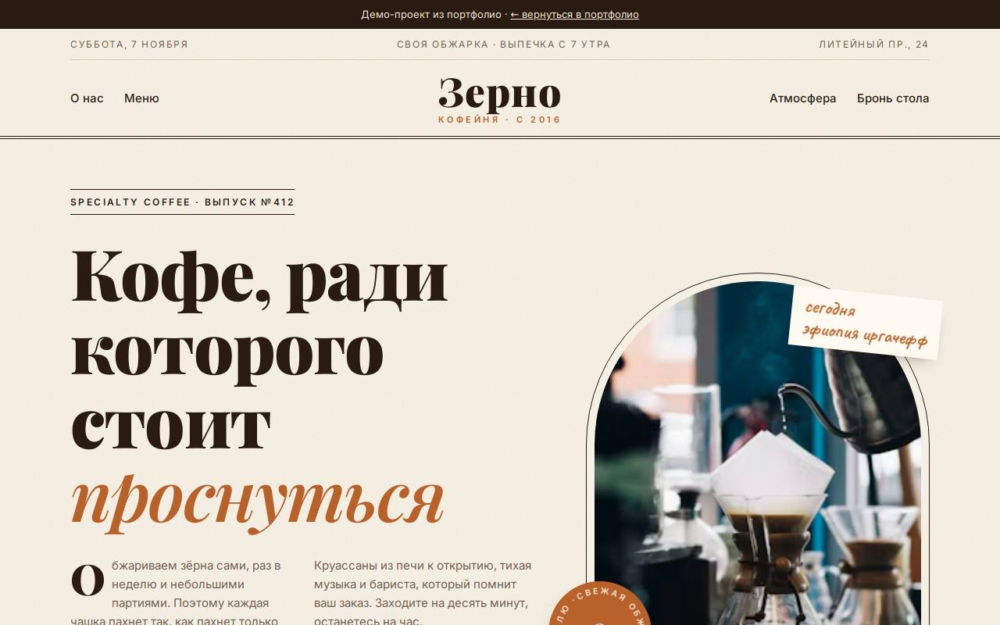 | [**Зерно**](https://feyegetsu.github.io/portfolio/projects/cafe/) | Общепит | Вёрстка в стиле газеты: печатное меню, полароиды, бронь-билет |
| 🤖 | [**Бот для заказов**](projects/cafe-bot/) | Telegram-бот | Python + aiogram 3: корзина, заказы в SQLite, уведомления админу, рассылки |

### Бэкенд и админка

Формы на всех сайтах отправляют данные в общий API, а владелец управляет ими в админке. Попробуйте сами: оставьте заявку на любом сайте и откройте [админку](https://feyegetsu.github.io/portfolio/admin/) (вход `demo@feyegetsu.dev` / `demo`). Поменяйте цену в каталоге или статус заказа, и Mini App обновится сам.

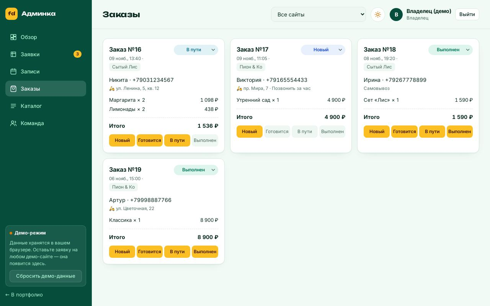

- **API на FastAPI**: заявки, запись на время без двойных записей, заказы с ценами из каталога, статистика, выгрузка в CSV.
- **Роли и доступ**: владелец, администратор, сотрудник; сотрудник видит только свои сайты.
- **Защита форм**: валидация телефона, honeypot, лимит заявок с одного IP.
- **93 автотеста** на pytest, включая регрессионные тесты по независимому QA-ревью, Docker и docker-compose с PostgreSQL, отдельная проверка в CI.
- **Цены считает сервер**: размеры, добавки, промокод и доставка; подменить цену из браузера нельзя.
- **Демо-режим.** На GitHub Pages сервер запустить нельзя, поэтому клиент [`api.js`](projects/shared/api.js) повторяет контракт и правила API прямо в браузере. С настоящим сервером он работает через параметр `?api=`.

Подробнее, со схемой и списком эндпоинтов: [backend/README.md](backend/README.md).

<div align="center">
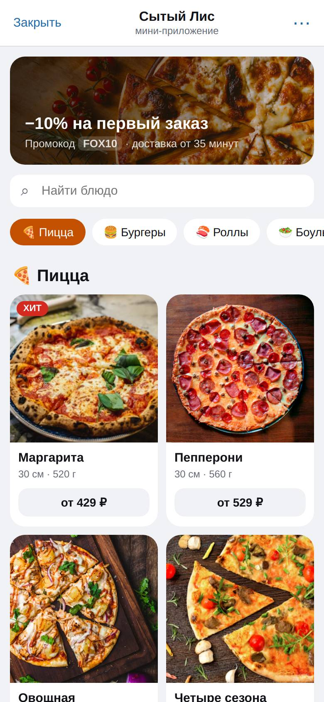
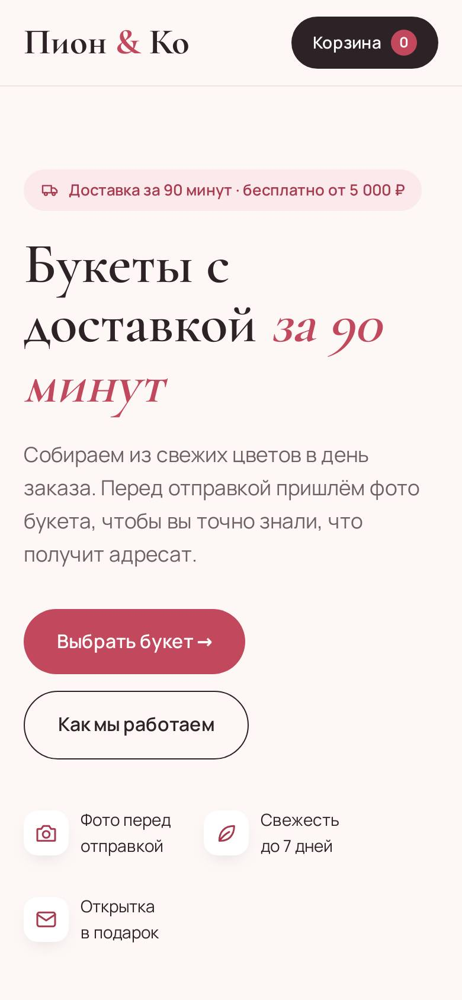
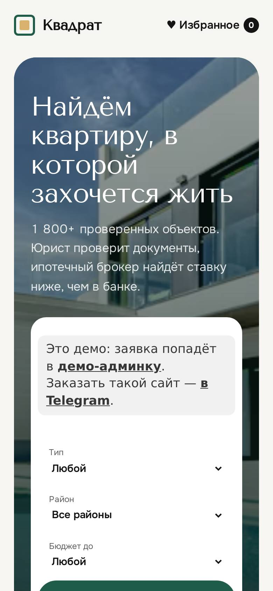
</div>

### Что есть в каждом демо

- Внизу каждого демо кнопка «Хочу такой сайт — N ₽»: она открывает калькулятор на главной с уже выбранными пунктами, как в этом проекте.
- После заявки, брони или заказа всплывает уведомление «что в эту секунду увидел администратор» в Telegram с только что введёнными данными.
- В подвале каждого демо честная подпись: компании, адреса, отзывы и цифры вымышлены.

### Кейсы

У каждого проекта есть кейс: задача бизнеса, что сделано, как устроено внутри, и живое превью, которое можно переключать между компьютером и телефоном. На кейс можно дать прямую ссылку, например [#case-miniapp](https://feyegetsu.github.io/portfolio/#case-miniapp).

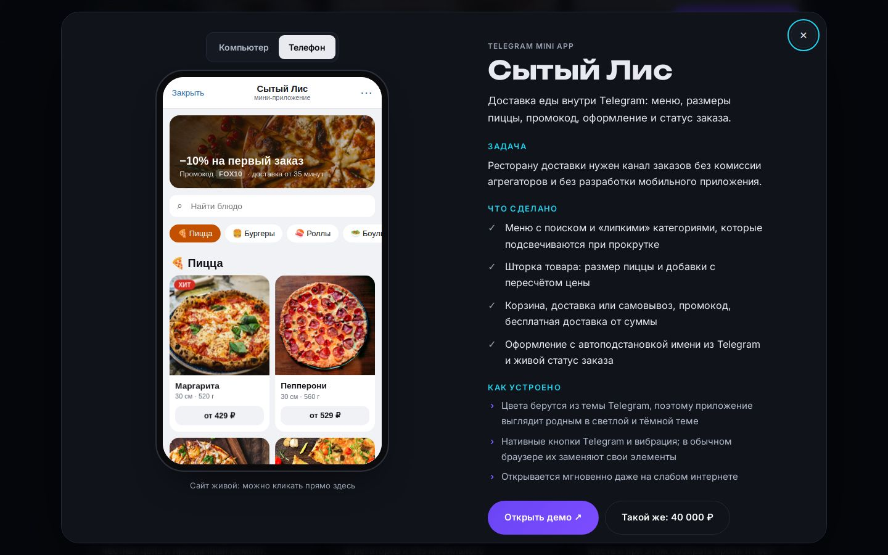

## Lighthouse и CI

Цифры не написаны руками: их считает Lighthouse в GitHub Actions при каждом изменении сайта и кладёт в [`assets/lighthouse.json`](assets/lighthouse.json).

<!-- LIGHTHOUSE:START -->
Замер от 2026-11-09. Страницы без пометки измерены в мобильном режиме (медленный 4G, слабый процессор).

| Страница | Скорость | Доступность | Практики | SEO | LCP |
|---|---|---|---|---|---|
| Главная (телефон) | 🟢 96 | 🟢 96 | 🟢 100 | 🟢 100 | 2.2 s |
| Главная (компьютер) | 🟢 93 | 🟢 100 | 🟢 100 | 🟢 100 | 1.2 s |
| Mini App | 🟢 91 | 🟢 96 | 🟢 100 | 🟢 100 | 2.8 s |
| Пион & Ко | 🟢 99 | 🟢 95 | 🟢 100 | 🟢 100 | 1.5 s |
| Белая линия | 🟢 99 | 🟢 96 | 🟢 100 | 🟢 100 | 1.8 s |
| Зерно | 🟢 99 | 🟢 96 | 🟢 100 | 🟢 100 | 2.0 s |
| BLADE | 🟢 100 | 🟢 95 | 🟢 100 | 🟢 100 | 1.7 s |
| PULSE | 🟢 99 | 🟢 96 | 🟢 100 | 🟢 100 | 2.0 s |
| МоторЛайн | 🟠 82 | 🟢 96 | 🟢 100 | 🟢 100 | 2.1 s |
| Квадрат | 🟢 99 | 🟢 97 | 🟢 100 | 🟢 100 | 2.0 s |
| Taskly | 🟢 99 | 🟢 100 | 🟢 100 | 🟢 100 | 1.7 s |
<!-- LIGHTHOUSE:END -->

- **CI на каждый пуш.** Бот проходит линтер `ruff` и проверку импорта, все HTML-страницы проверяются на битые ссылки.
- **Демо считает как сервер.** Правила сайтов и каталоги живут в одном месте, `backend/app/sites.py` и `seed.py`; демо-клиент получает их сгенерированную копию, и тест падает, если она устарела. Одни и те же 32 примера (цены, размеры, промокоды, доставка, слоты записи) прогоняются по серверному коду в pytest и по коду демо в Node.
- **Демо прописаны везде.** `tools/demos.py check` проверяет, что каждое демо есть на главной, в ценах, в sitemap, README и на сервере, и что на страницах нет заглушек.
- **Сборка перед публикацией.** Сайт публикуется не из репозитория как есть, а после `tools/build.py`: содержимое, которое рисует JavaScript, записывается прямо в HTML для поисковиков, CSS и JS минифицируются, к файлам добавляется версия для сброса кэша.
- **Скриншоты обновляются сами.** Playwright снимает каждый проект и OG-картинку и коммитит их в `assets/`.
- **Доступность.** Семантическая разметка, фокус с клавиатуры, модальные окна на `<dialog>`, учёт `prefers-reduced-motion`.
- **SEO.** Мета-теги, Open Graph, JSON-LD `ProfessionalService`, `sitemap.xml`, `robots.txt`, canonical.

## Как устроено

```
index.html, styles.css, script.js   главная: работы, кейсы, калькулятор стоимости, демо бота
privacy.html                        политика обработки данных
projects/
  miniapp/                          Telegram Mini App (Telegram WebApp API)
  florist/ dental/ realty/ saas/
  restaurant/ sushi/ gastrobar/ bar/
  autoservice/ fitness/ barbershop/ cafe/
  shared/motion.js                  анимации через data-атрибуты: появление, параллакс, счётчики
  shared/api.js                     клиент API: настоящий сервер или демо-режим в браузере
  shared/offers.js                  цены и сроки услуг: калькулятор, карточки работ, кнопки в демо
  cafe-bot/                         Telegram-бот на Python (aiogram 3, SQLite)
admin/                              админ-панель: дашборд, заявки, записи, заказы, каталог, команда
backend/                            API на FastAPI: модели, роуты, тесты, Dockerfile, docker-compose
  shared/kit.css, kit.js            общий набор для новых демо: сетка, кнопки, формы, уведомления
  demos.json                        реестр демо-сайтов
  _template/                        заготовка нового демо
tools/
  build.py                          сборка: пререндер для поиска, минификация, версии файлов
  demos.py                          проверка демо и создание нового из заготовки
  parity.mjs                        демо-клиент считает так же, как сервер (Node)
  screenshots.py                    скриншоты и OG-картинка (Playwright)
  lh_summary.py                     сводка отчётов Lighthouse
render.yaml                         деплой API, PostgreSQL и Redis на Render одной кнопкой
.github/workflows/
  ci.yml                            тесты API, паритет с демо, проверка демо, ссылки, сборка Docker
  deploy.yml                        сборка сайта и публикация на GitHub Pages
  screenshots.yml                   скриншоты и Lighthouse с автокоммитом
```

**Почему фронтенд без фреймворков.** Для сайтов малого бизнеса важнее всего скорость загрузки с мобильного и простота поддержки. Чистые HTML, CSS и JS открываются с любого хостинга, а каждый демо-проект — один файл, который легко взять за основу под реального клиента. Сборка нужна только для публикации и ничего не меняет в исходниках: страницы по-прежнему открываются локально как есть. Сложная логика живёт на сервере.

**Новое демо** создаётся одной командой, она копирует заготовку и прописывает проект во всех нужных местах:

```bash
python tools/demos.py new coffee "Кофейня «Пенка»" --niche "Кофейня" --type site --opts booking,tg
python tools/demos.py check
```

**Сборка локально** (нужны Playwright и Node):

```bash
pip install playwright && python -m playwright install chromium
python tools/build.py          # результат в _site/
```

## Запуск локально

```bash
git clone https://github.com/feyegetsu/portfolio.git
cd portfolio
python -m http.server 8000
```

Откройте http://localhost:8000. Контакты, число оставшихся пилотных мест, имя, город, статус и фото для блока «Кто это делает» задаются в одном месте: объект `CONFIG` в начале [`script.js`](script.js). Пустые поля на сайте просто не показываются. Цены и сроки услуг — в [`projects/shared/offers.js`](projects/shared/offers.js), калькулятор и карточки берут их оттуда.

Бэкенд запускается одной командой `docker compose up` из папки [`backend`](backend/README.md). Бот запускается отдельно, инструкция в [`projects/cafe-bot/README.md`](projects/cafe-bot/README.md).

## Лицензия

Код распространяется по лицензии [MIT](LICENSE). Фото загружаются с [Unsplash](https://unsplash.com/license), шрифты с Google Fonts. Компании, люди, отзывы и цифры в демо-проектах вымышлены.
