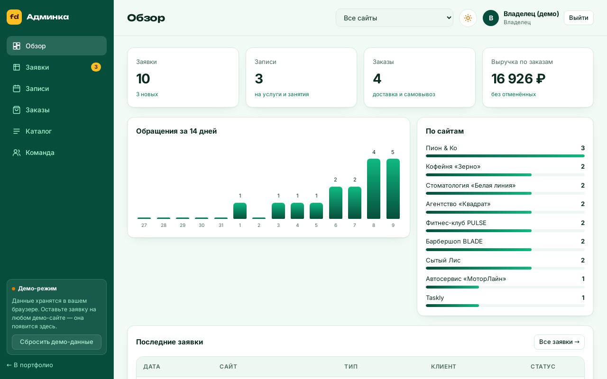
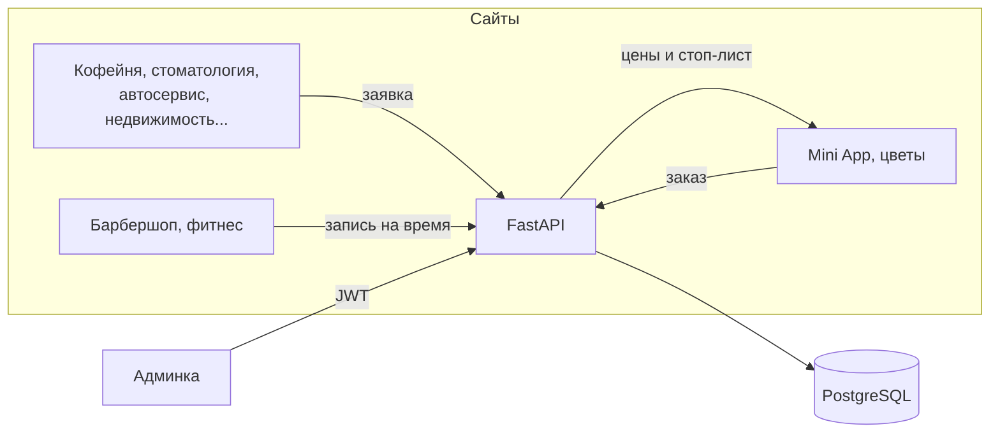

# Portfolio API

Общий бэкенд для всех демо-сайтов портфолио: заявки, запись на время, заказы, каталог и админка с ролями.

**[Админка (демо) →](https://feyegetsu.github.io/portfolio/admin/)** · вход `demo@feyegetsu.dev` / `demo`



## Архитектура



Один сервис обслуживает все сайты: у каждого сайта свой набор возможностей (`app/sites.py`), а сотрудник видит только те сайты, к которым у него есть доступ.

## Что внутри

| | |
|---|---|
| **Стек** | Python 3.12, FastAPI, SQLAlchemy 2, PostgreSQL (локально SQLite), PyJWT |
| **Авторизация** | JWT, пароли PBKDF2-SHA256, роли `owner` / `admin` / `staff`, доступ по сайтам |
| **Защита форм** | валидация и нормализация телефона, honeypot от ботов, лимит заявок с одного IP |
| **Запись на время** | двойная запись на один слот исключена уникальным ключом в БД, а не проверкой в коде, поэтому работает и при одновременных запросах; отмена освобождает слот |
| **Заказы** | сервер сам считает цену по каталогу, размеры и добавки по таблице, промокод и доставку; цена из запроса не используется, неизвестная позиция отклоняется, стоп-лист проверяется. Статус заказа отдаётся по секретному токену, а не по номеру |
| **Админка** | списки с поиском, фильтрами и пагинацией, смена статусов, каталог, команда, статистика, экспорт в CSV для Excel |
| **Безопасность** | без `SECRET_KEY` и пароля владельца API не стартует, ограничение попыток входа, защита от CSV-инъекции, лимит размера запроса и заявок с одного IP |
| **Запись** | по сетке слотов, в часы работы и на горизонт вперёд, в часовом поясе заведения; места на занятиях и столы ограничены |
| **Качество** | 93 автотеста на pytest: регрессионные тесты по QA-отчёту, общие с демо-клиентом примеры расчёта, лимиты в Redis, ruff, сборка Docker-образа в CI на каждый пуш |

## API

Полная интерактивная документация после запуска: `http://localhost:8080/docs`.

| Метод | Путь | Кто | Что делает |
|---|---|---|---|
| POST | `/api/v1/sites/{site}/leads` | все | заявка с формы |
| GET | `/api/v1/sites/{site}/slots?resource=&date=` | все | занятые слоты на день |
| POST | `/api/v1/sites/{site}/bookings` | все | запись на время (409, если занято) |
| POST | `/api/v1/sites/{site}/orders` | все | заказ |
| GET | `/api/v1/sites/{site}/orders/{id}` | все | статус заказа для экрана отслеживания |
| GET | `/api/v1/sites/{site}/catalog` | все | каталог с ценами и наличием |
| POST | `/api/v1/auth/login` | все | вход, выдаёт JWT |
| GET | `/api/v1/admin/leads`, `/bookings`, `/orders` | staff+ | списки с фильтрами |
| PATCH | `/api/v1/admin/leads/{id}` и т. п. | staff+ | смена статуса |
| GET | `/api/v1/admin/leads.csv` | staff+ | выгрузка для Excel |
| GET | `/api/v1/admin/stats` | staff+ | цифры для дашборда |
| POST/PATCH/DELETE | `/api/v1/admin/catalog/...` | admin+ | управление каталогом |
| GET/POST/DELETE | `/api/v1/admin/users` | owner | команда |

## Запуск

**Docker (API + PostgreSQL):**

```bash
cp .env.example .env    # впишите SECRET_KEY и OWNER_PASSWORD: без них API не запустится
docker compose up --build
```

**Без Docker (SQLite):**

```bash
pip install -r requirements-dev.txt
ENV=development uvicorn app.main:app --reload --port 8080
```

`ENV=development` разрешает ключ и пароль по умолчанию. Без него API проверит секреты при старте и откажется работать с небезопасными значениями.

**Тесты:**

```bash
pytest
```

## Подключить сайты к этому API

Фронтенд сайтов и админки работает через общий клиент [`projects/shared/api.js`](../projects/shared/api.js). По умолчанию он в демо-режиме: тот же контракт и те же правила, но данные хранятся в браузере. Так всё работает на GitHub Pages, где сервер запустить нельзя.

Чтобы переключиться на настоящий сервер, откройте любую страницу с параметром:

```
https://feyegetsu.github.io/portfolio/admin/?api=https://адрес-вашего-api
```

Адрес запомнится в браузере, `?api=off` вернёт демо-режим. В `CORS_ORIGINS` у API должен быть домен сайта.

Сервер не на своём компьютере подключается только после подтверждения во всплывающем окне: так ссылка с чужим `?api=` не уведёт пароль от админки. В проекте для клиента адрес API зашивается в страницу (`window.PORTFOLIO_API`), и параметр ссылки тогда не работает вовсе.

## Деплой

В корне репозитория лежит [`render.yaml`](../render.yaml): на Render это Dashboard → New → Blueprint → репозиторий. Поднимутся API из этого Dockerfile, PostgreSQL и Key Value (Redis) для лимитов; `SECRET_KEY` сгенерируется сам, e-mail и пароль владельца Render спросит при создании. Адрес базы вида `postgres://…` API переводит в формат драйвера сам, порт берёт из `PORT`.

`GET /health` отвечает `{"status": "ok", "db": "ok", "limits": "redis"}` и возвращает 503, если база недоступна: по нему хостинг понимает, что API пора перезапустить. На том же адресе стоит `HEALTHCHECK` в Docker-образе.

На Render запросы приходят через балансировщик, поэтому `FORWARDED_ALLOW_IPS` там `*`. На своём сервере за nginx укажите конкретный адрес прокси: так IP посетителя нельзя подделать заголовком.

## Для продакшена

- **Миграции.** Сейчас таблицы создаются при старте, в продакшене это делает Alembic.
- **Лимит частоты.** С `REDIS_URL` счётчик общий для всех копий API (`docker compose up --scale api=2` работает из коробки), без него — в памяти процесса. Если Redis недоступен, лимит не применяется, а в лог пишется предупреждение: лучше пропустить лишнюю заявку, чем перестать принимать заказы. За nginx укажите адрес прокси в `FORWARDED_ALLOW_IPS`, иначе все посетители будут видны с одного IP.
- **152-ФЗ.** Персональные данные граждан РФ храните на серверах в России, на сайте нужны согласие на обработку и политика конфиденциальности.
- **Секреты.** `SECRET_KEY` (от 32 символов) и пароль первого владельца задаются только через переменные окружения, иначе API не стартует.
