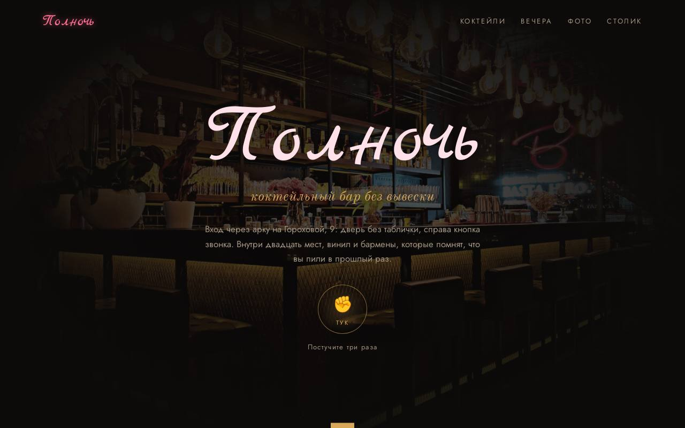

# Полночь — коктейльный бар

**[Открыть демо →](https://feyegetsu.github.io/portfolio/projects/bar/)**

**Задача.** Бару без вывески нужно сохранить атмосферу секретного места и при этом собирать брони и гест-лист.

**Что сделано**
- Проверка возраста 18+
- «Постучите три раза»: пароль дня и кнопка брони
- Коктейли по вкусу с рецептом и крепостью
- Подбор коктейля за три вопроса, гест-лист и бронь

**Под капотом**
- Бронь после полуночи записывается на правильную дату
- Гест-лист и бронь уходят в API и видны в админке
- На сенсорных экранах рецепт открывается кнопкой, а не наведением

Один HTML-файл без сборки. Анимации из общего [`motion.js`](../shared/motion.js), фотоальбомы из [`gallery.js`](../shared/gallery.js), данные через [`api.js`](../shared/api.js).
