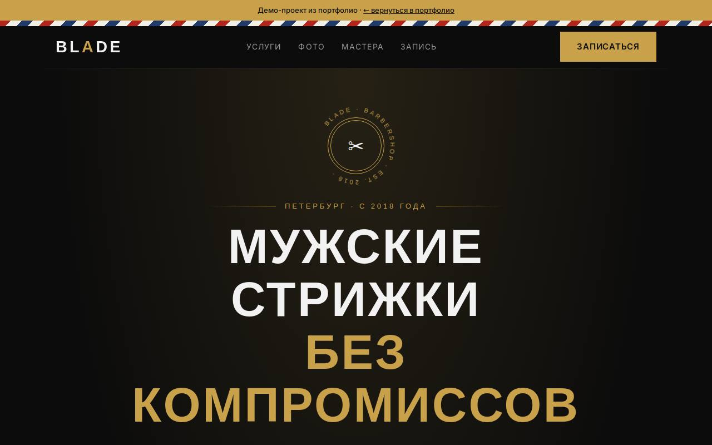

# BLADE — барбершоп

**[Открыть демо →](https://feyegetsu.github.io/portfolio/projects/barbershop/)**

**Задача.** Барбершопу нужно, чтобы клиенты записывались сами, в любое время.

**Что сделано**
- Запись в три шага с прогресс-баром и сводкой
- Календарь на неделю со свободными слотами
- Фотоальбомы и карточки мастеров

**Под капотом**
- Прошедшие сегодня слоты блокируются по текущему времени
- Занятые слоты приходят из API: на одно время к мастеру записывается только один человек

Один HTML-файл без сборки. Анимации из общего [`motion.js`](../shared/motion.js), фотоальбомы из [`gallery.js`](../shared/gallery.js), данные через [`api.js`](../shared/api.js).
