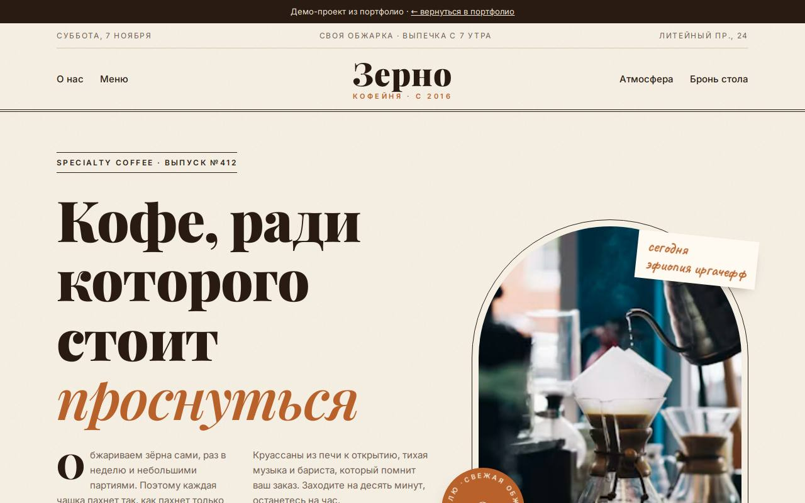

# Зерно — кофейня

**[Открыть демо →](https://feyegetsu.github.io/portfolio/projects/cafe/)**

**Задача.** Кофейне нужен сайт, где видно меню с ценами и можно забронировать столик.

**Что сделано**
- Вёрстка в стиле газеты: шапка с датой выпуска, статья в три колонки, буквица
- Меню как печатная карта: название, точки до цены, переключение разделов
- Полароиды и бронь столика в виде билета

**Под капотом**
- Нельзя выбрать прошедшую дату
- Ленивая загрузка фото нужного размера
- Надпись по кругу на печати сделана SVG-текстом по контуру

Один HTML-файл без сборки. Анимации из общего [`motion.js`](../shared/motion.js), фотоальбомы из [`gallery.js`](../shared/gallery.js), данные через [`api.js`](../shared/api.js).
