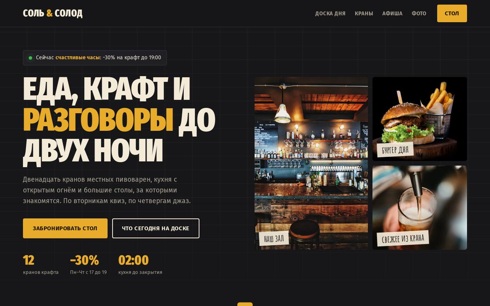

# Соль и Солод — гастробар

**[Открыть демо →](https://feyegetsu.github.io/portfolio/projects/gastrobar/)**

**Задача.** Гастробару нужно, чтобы гости приходили на события и бронировали столы на квиз и концерты.

**Что сделано**
- Статус «прямо сейчас»: открыто ли и идут ли счастливые часы
- Меловая доска блюд дня по дням недели
- Краны с крепостью и горечью, фильтр по стилю
- Подбор пива к блюду, афиша с записью и бронь по зонам

**Под капотом**
- Запись на событие и бронь уходят в API и видны в админке
- Афиша строится от сегодняшней даты
- Цены на кранах сами снижаются в счастливые часы

Один HTML-файл без сборки. Анимации из общего [`motion.js`](../shared/motion.js), фотоальбомы из [`gallery.js`](../shared/gallery.js), данные через [`api.js`](../shared/api.js).
