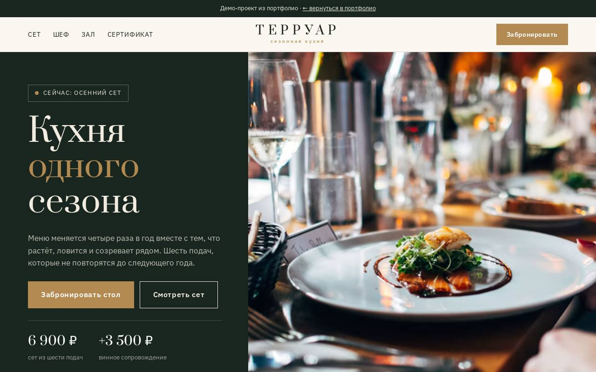

# Терруар — ресторан сезонной кухни

**[Открыть демо →](https://feyegetsu.github.io/portfolio/projects/restaurant/)**

**Задача.** Ресторану высокой кухни нужно продавать впечатление и заполнять 28 мест бронями заранее.

**Что сделано**
- Четыре сезонных меню, текущий сезон выбирается сам
- Лента из шести подач и винное сопровождение с пересчётом цены
- Бронь стола: дата, свободное время, гости, повод, сумма на всех
- Подарочные сертификаты и фотоальбомы зала, кухни и погреба

**Под капотом**
- Бронь и сертификаты уходят в общий API и видны в админке
- Прошедшее время и выходной недоступны
- По умолчанию выбран ближайший день со свободными столами

Один HTML-файл без сборки. Анимации из общего [`motion.js`](../shared/motion.js), фотоальбомы из [`gallery.js`](../shared/gallery.js), данные через [`api.js`](../shared/api.js).
