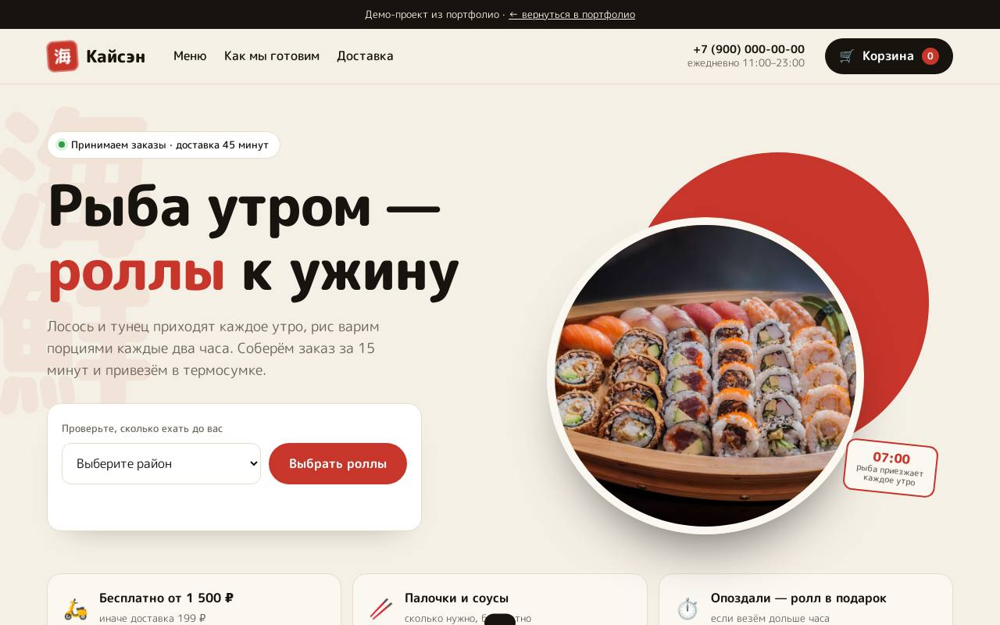

# Кайсэн — доставка суши

**[Открыть демо →](https://feyegetsu.github.io/portfolio/projects/sushi/)**

**Задача.** Суши-бару нужен свой канал заказов без комиссии агрегаторов, где цены и стоп-лист меняют без программиста.

**Что сделано**
- Меню по разделам с липкой навигацией
- Проверка района: время в пути и условия доставки
- Корзина-шторка: палочки, доставка или самовывоз, прогресс до бесплатной доставки
- Экран статуса заказа после оформления

**Под капотом**
- Цены и стоп-лист приходят из каталога API, ими управляют в админке
- Итог сервер считает по своим ценам
- Корзина и район сохраняются между визитами

Один HTML-файл без сборки. Анимации из общего [`motion.js`](../shared/motion.js), данные через [`api.js`](../shared/api.js).
